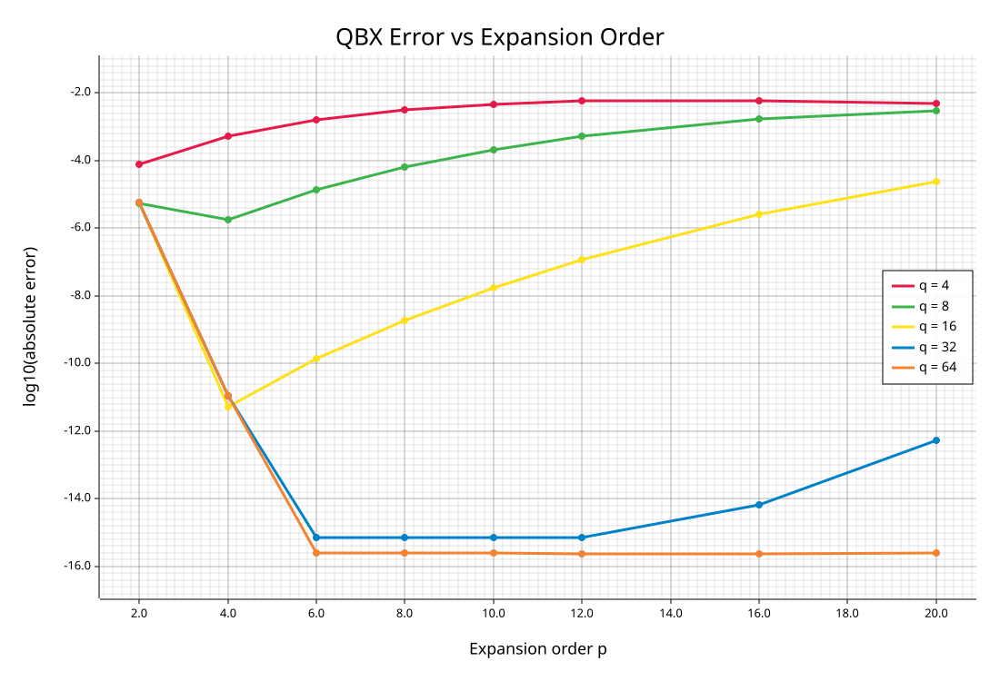
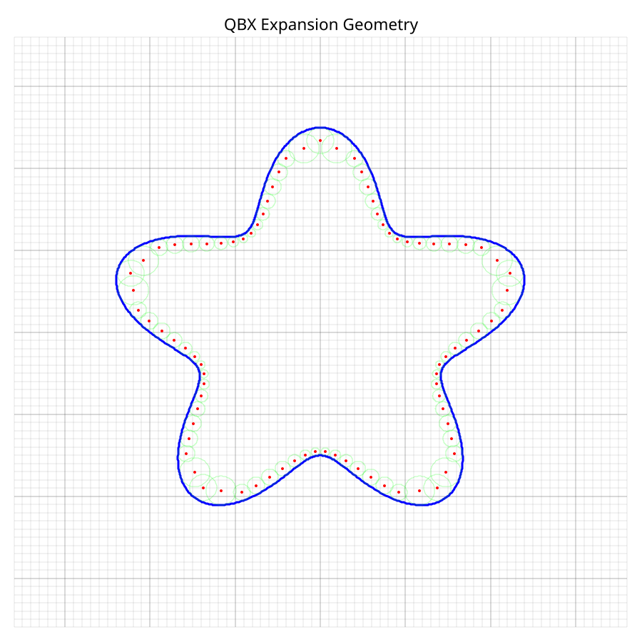
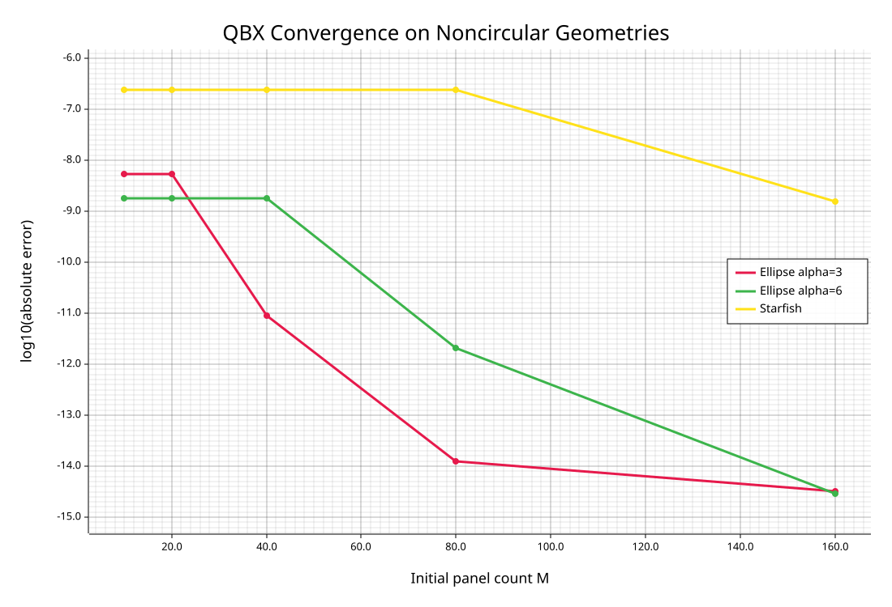

https://arxiv.org/pdf/1207.4461

## circle, error calculation done from analytical solution

## geometry after bisecting based on tail and twice arc length

## convergence of error for non circle geometry, error calculation done from reference with panel count = 200

